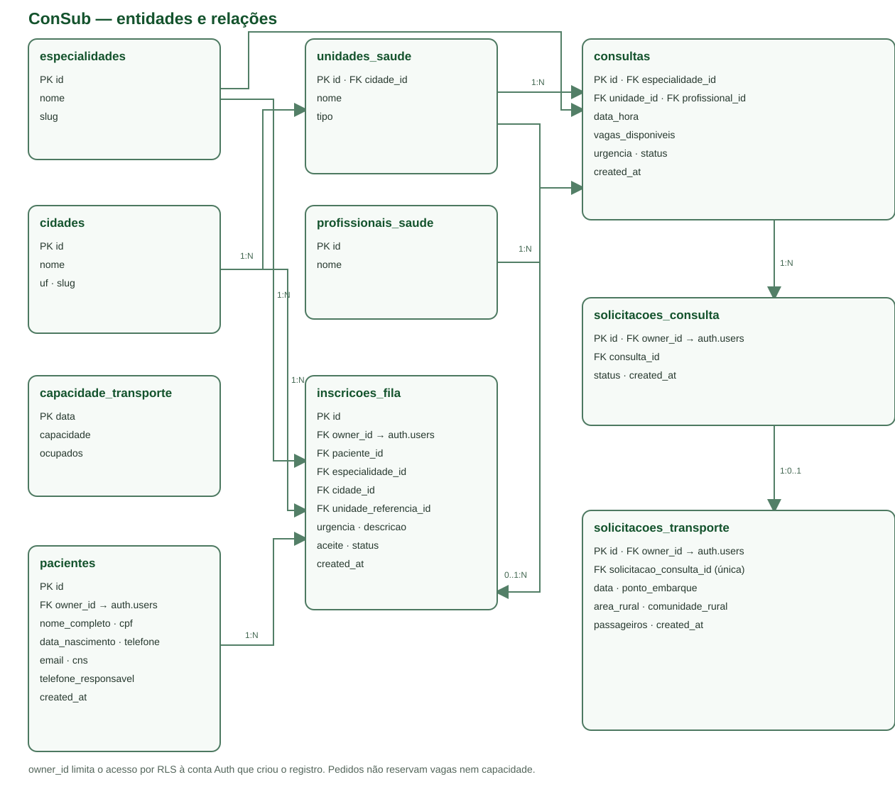
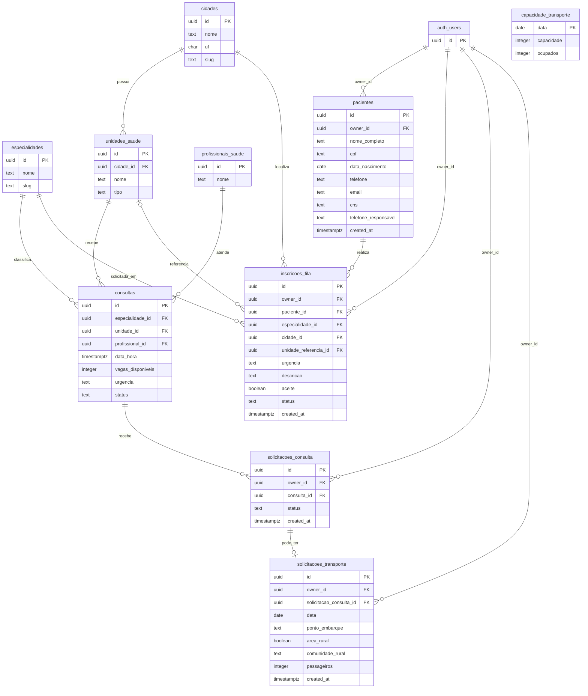

# Modelo ER — ConSub

O modelo abaixo corresponde às tabelas da migração SQL. Os dados de catálogo e as capacidades iniciais vêm de `supabase/seed.sql`.

## Entidades e relações

## Acesso e integridade

- Todas as tabelas expostas têm RLS habilitada. O papel `anon` não recebe grants de leitura ou escrita.
- Os catálogos podem ser lidos por sessões autenticadas. Tabelas pessoais são limitadas a `owner_id = auth.uid()`.
- `owner_id` usa `auth.uid()` como valor padrão no banco e não é enviado pelo formulário.
- O índice parcial de `inscricoes_fila` impede duplicidade ativa para a mesma pessoa, especialidade, cidade e unidade de referência.
- As funções RPC salvam inscrição e pedido de consulta/transporte em operações atômicas.
- Um pedido de consulta não cria agendamento nem modifica `vagas_disponiveis` ou `capacidade_transporte.ocupados`.
- Os cenários de dengue e faltas não têm tabelas: continuam somente no navegador.

## Chaves

| Tabela | Chaves estrangeiras |
|---|---|
| `unidades_saude` | `cidade_id → cidades.id` |
| `consultas` | `especialidade_id → especialidades.id`; `unidade_id → unidades_saude.id`; `profissional_id → profissionais_saude.id` |
| `pacientes` | `owner_id → auth.users.id` |
| `inscricoes_fila` | `owner_id → auth.users.id`; `paciente_id → pacientes.id`; `especialidade_id → especialidades.id`; `cidade_id → cidades.id`; `unidade_referencia_id → unidades_saude.id` (opcional) |
| `solicitacoes_consulta` | `owner_id → auth.users.id`; `consulta_id → consultas.id` |
| `solicitacoes_transporte` | `owner_id → auth.users.id`; `solicitacao_consulta_id → solicitacoes_consulta.id` (única) |
