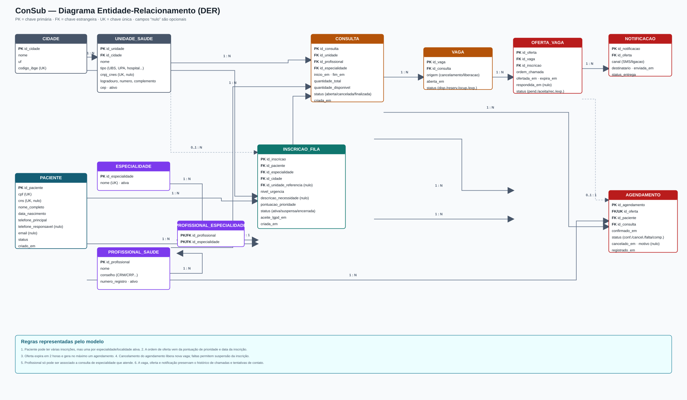

# Modelo ER — ConSub

Baseado nas telas e regras do projeto: inscrição em fila por especialidade e localidade; vagas oriundas de cancelamentos; prioridade; contato por SMS/ligação; aceite em até duas horas; e controle de comparecimento, cancelamento e suspensão.

## Legenda

- **PK**: chave primária.
- **FK**: chave estrangeira.
- **UK**: chave única (identificador alternativo).
- `nulo`: campo opcional.
- Nas setas, `1 : N` representa um-para-muitos. A inscrição pode não ter UBS de referência e uma oferta pode ainda não ter agendamento (`0..1`).

## Chaves por tabela

| Tabela | Chave primária | Chaves estrangeiras |
|---|---|---|
| `paciente` | `id_paciente` | — |
| `cidade` | `id_cidade` | — |
| `unidade_saude` | `id_unidade` | `id_cidade` → `cidade.id_cidade` |
| `especialidade` | `id_especialidade` | — |
| `profissional_saude` | `id_profissional` | — |
| `profissional_especialidade` | composta: `id_profissional`, `id_especialidade` | `id_profissional` → `profissional_saude.id_profissional`; `id_especialidade` → `especialidade.id_especialidade` |
| `inscricao_fila` | `id_inscricao` | `id_paciente` → `paciente.id_paciente`; `id_especialidade` → `especialidade.id_especialidade`; `id_cidade` → `cidade.id_cidade`; `id_unidade_referencia` → `unidade_saude.id_unidade` *(opcional)* |
| `consulta` | `id_consulta` | `id_unidade` → `unidade_saude.id_unidade`; `id_profissional` → `profissional_saude.id_profissional`; `id_especialidade` → `especialidade.id_especialidade` |
| `vaga` | `id_vaga` | `id_consulta` → `consulta.id_consulta` |
| `oferta_vaga` | `id_oferta` | `id_vaga` → `vaga.id_vaga`; `id_inscricao` → `inscricao_fila.id_inscricao` |
| `notificacao` | `id_notificacao` | `id_oferta` → `oferta_vaga.id_oferta` |
| `agendamento` | `id_agendamento` | `id_oferta` → `oferta_vaga.id_oferta` *(única)*; `id_paciente` → `paciente.id_paciente`; `id_consulta` → `consulta.id_consulta` |

## Regras de integridade recomendadas

1. `paciente.cpf` deve ser único; `cns`, se informado, também. Dados sensíveis devem ser protegidos conforme a LGPD.
2. Uma inscrição é única enquanto ativa para o conjunto `(id_paciente, id_especialidade, id_cidade, id_unidade_referencia)`; assim, o paciente pode entrar em várias especialidades sem duplicar a mesma fila.
3. A oferta só pode ser criada se a vaga estiver `disponivel` e a inscrição estiver `ativa`, na mesma especialidade e localidade compatível.
4. Uma oferta expira em duas horas. Ao aceitar, ela cria no máximo um `agendamento`, reserva/ocupa a vaga e impede outro aceite para a mesma vaga.
5. Cancelamento de `agendamento` libera nova `vaga`; faltas devem alimentar a regra de suspensão temporária após três ocorrências sem aviso.
6. Validar que o profissional atende a especialidade da consulta por `profissional_especialidade`.
