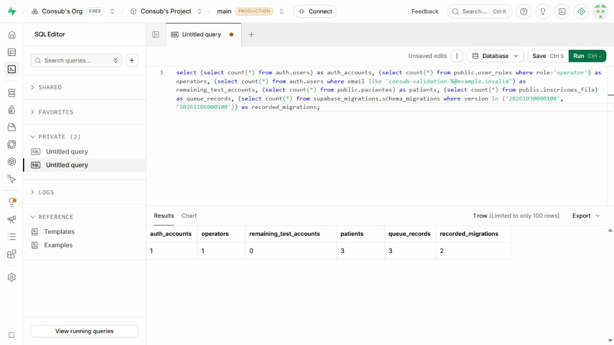
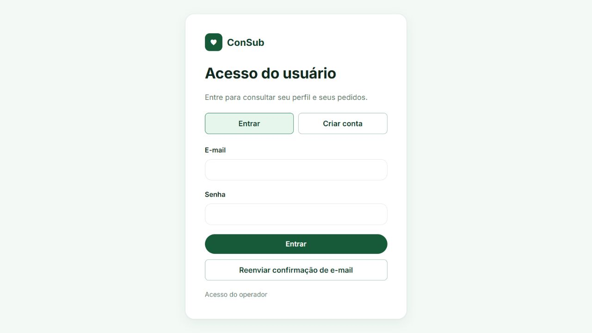

# Validação de cadastro e permissões

Validação executada em 6 de novembro de 2026 no projeto Supabase existente e na aplicação servida em `http://127.0.0.1:5173`.

## Banco de dados

O roteiro [public_user_access.sql](../supabase/validation/public_user_access.sql) foi executado no SQL Editor como `postgres`. Ele cria duas contas Auth sintéticas dentro de uma transação, assume o papel PostgreSQL `authenticated` e alterna a identidade da sessão para testar as políticas e funções de cada conta. Ao terminar, executa `ROLLBACK`. Isso verifica o comportamento do banco sob cada identidade; não substitui um teste de login com tokens emitidos pelo Auth nem a confirmação por e-mail.

Resultado retornado pelo roteiro:

```text
PASS: two users isolated; own profile, requests and cancellation;
no role escalation; operator management; capacity unchanged;
all test data rolled back
```

| Verificação | Resultado |
| --- | --- |
| Novas contas recebem `user`, mesmo com `role: operator` em metadados editáveis | Passou |
| Uma única pessoa por conta de usuário | Passou: segundo perfil rejeitado |
| Criar e editar o próprio perfil pelas funções autorizadas | Passou |
| Criar inscrição, pedido de consulta e pedido de transporte | Passou |
| `owner_id` enviado pelo cliente não permite criar dados para outra conta | Passou |
| Leitura, edição e exclusão direta de dados de outra conta | Bloqueadas nas quatro tabelas, nos dois sentidos |
| Cancelar pedido ou inscrição de outra conta | Bloqueado |
| Cancelar a própria inscrição e pedido, removendo o transporte associado | Passou |
| Atualizar diretamente a tabela protegida de papéis para autopromoção | Bloqueado |
| Operador consultar e editar perfis de ambas as contas | Passou |
| Operador mudar status de inscrições e editar transporte | Passou |
| Operador excluir perfis e pedidos de ambas as contas | Passou |
| Operador usar as funções de criação destinadas ao usuário | Bloqueado |
| Transferir `owner_id` nas quatro tabelas, inclusive como operador | Bloqueado |
| Pedidos reduzirem vagas ou ocuparem transporte | Não ocorreu |
| Acesso anônimo a dados pessoais e função de perfil | Bloqueado |

Após a reversão dos testes, uma consulta independente confirmou:

| Estado remoto final | Quantidade |
| --- | ---: |
| Contas Auth | 1 |
| Operadores | 1 |
| Contas sintéticas criadas pelo roteiro e ainda presentes | 0 |
| Pacientes históricos preservados | 3 |
| Inscrições históricas preservadas | 3 |
| Migrações registradas no histórico | 2 |



A migração de papéis, aplicada anteriormente pelo SQL Editor, foi reconciliada no histórico com [reconcile_public_user_roles_history.sql](../supabase/operations/reconcile_public_user_roles_history.sql). Nenhuma migração aplicada foi editada e nenhum reset foi realizado.

## API pública

O comando abaixo foi executado usando somente a URL e a chave pública do frontend em `.env.local`, sem sessão ou chave administrativa:

```powershell
node .\supabase\validation\anonymous_api.mjs
```

O script confirmou cadastro público habilitado, confirmação de e-mail obrigatória, provedor Email habilitado e acesso anônimo desativado. Chamadas REST sem sessão receberam `42501` ao consultar `pacientes`, `inscricoes_fila`, `solicitacoes_consulta`, `solicitacoes_transporte`, `user_roles` e `perfis_usuarios`, e ao invocar `meu_papel`.

As URLs remotas também foram conferidas no painel: Site URL `http://127.0.0.1:5173`; retornos permitidos somente para essa raiz e `/conta.html`.

## Interface local e build

- Painel do operador carregou os três pacientes e inscrições com uma sessão autenticada existente.
- Formulário de edição do operador foi aberto e salvo com os valores existentes.
- Saída de sessão redirecionou para o acesso do usuário.
- Sem sessão, as rotas de usuário e operador redirecionaram para o login.
- Alternância entre entrar e criar conta, campos obrigatórios e aviso de confirmação foram conferidos.
- Um retorno com erro de confirmação exibiu mensagem de link inválido/expirado e limpou os parâmetros da URL.
- O retorno de confirmação e reenvio usa exatamente `/conta.html`, presente na lista permitida.
- Nenhuma mensagem de erro de JavaScript apareceu durante a revisão do painel.
- O carregamento do script compartilhado foi corrigido no painel para disponibilizar também o menu de navegação em telas pequenas. O controle de viewport do navegador não aplicou a dimensão pretendida; a revisão visual responsiva não é considerada concluída.
- `npm run build` foi executado após os ajustes.



## Confirmação por e-mail: pendência explícita

Não foi executado o fluxo completo de cadastro, recebimento do e-mail, abertura do link e login de uma nova conta de usuário. O responsável informou que não tem uma segunda caixa de entrada acessível já integrante da equipe Supabase. Também não foram mantidas contas de teste confirmadas artificialmente.

O SMTP padrão só entrega para endereços da equipe e atualmente permite 2 e-mails por hora. Fontes: [SMTP do Supabase](https://supabase.com/docs/guides/auth/auth-smtp) e [limites de autenticação](https://supabase.com/docs/guides/auth/rate-limits).

Para concluir essa verificação futuramente:

1. Disponibilize uma segunda caixa de entrada como membro da equipe do projeto, ou configure SMTP próprio para permitir endereços externos.
2. Com o site em localhost, abra `/conta.html`, escolha criar conta e preencha e-mail e senha diretamente no navegador.
3. Confirme o endereço pelo link recebido e verifique o retorno para `/conta.html`.
4. Entre, complete o perfil, registre e cancele uma inscrição e um pedido de consulta/transporte pela área do usuário.
5. Verifique esses registros no painel do operador.

Até essa etapa, a edição e os cancelamentos próprios estão validados no banco, mas o percurso completo da nova conta na interface permanece pendente. O site não foi publicado em hospedagem.
